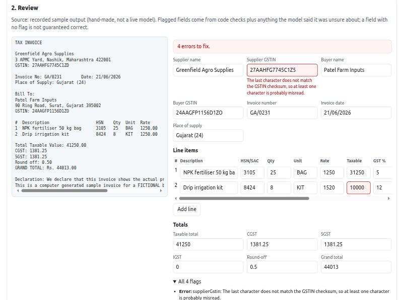

# GST invoice extraction with human review (demo)

A small portfolio demo by Rajkamal Das. A model reads an Indian GST tax invoice (text, image or PDF) into structured
fields; **plain code then checks it** (GSTIN checksum, tax maths, same-state vs other-state tax); and **a person reviews
and fixes what is flagged** before exporting a CSV or JSON file.

> **This is a demo, not a client product or a compliance tool.** Every invoice, business name and GSTIN in it is fictional.
> It runs on a free-tier model, and I have **not** run it against a real model (see [What was verified](#what-was-verified-and-what-was-not)).



*The review screen on the "needs review" sample, in recorded-sample mode (hand-made output standing in for a model, not a live model).
The misread GSTIN and the wrong line value are flagged because code checks fail.*

## The idea

A model is good at reading messy documents and bad at being trusted with arithmetic and identifiers. So the work is split:

| Step | Who | What |
|---|---|---|
| Read | Model (Gemini, structured JSON output) | Copy what is printed into fields; use `null` when unreadable; list fields it was unsure about. It is told not to calculate or correct anything. |
| Check | Code (deterministic, tested) | Validates the output the same way every time, whichever model produced it. |
| Decide | Person | Edits flagged fields (flags re-evaluate as you type), then approves. Export is blocked while errors remain unless the reviewer explicitly overrides. |

Checks in `src/lib/validate.ts`:

- Supplier and buyer **GSTIN**: format, state code, PAN entity type and the base-36 **checksum** (catches every single-character misread).
- **Date** is a real date (DD/MM/YYYY etc.) and not in the future.
- **HSN/SAC** is 4, 6 or 8 digits; **GST rate** is a standard slab.
- Per line: quantity × rate = taxable value; taxable × rate = tax; line total = taxable + tax (within a ₹1 rounding tolerance).
- **Supply type**: supplier state vs place of supply decides CGST + SGST (same state) or IGST (other state); the wrong one is an error.
- **Totals**: lines add up to the document totals; taxable + tax + round-off = grand total.
- Anything the model reported as "unsure" is shown as a warning on that field.

## Run it

Requires Node 20+.

```bash
npm install
npm run dev          # http://localhost:3000, uses webpack (not Turbopack)
```

With no key it runs in **recorded-sample mode**: the three fictional samples work and uploads are switched off. To use a
live model, copy `.env.example` to `.env.local` and set your own free `GEMINI_API_KEY`.

```bash
npm test             # 40 tests (vitest)
npm run typecheck
npm run eval         # offline eval, no model call (see below)
npm run build        # next build --webpack
npm run samples      # regenerates data/samples + src/generated/samples.ts
```

**Testing the live path without a key:** `npx tsx scripts/fake-gemini.ts &` then
`GEMINI_API_BASE=http://127.0.0.1:4010 GEMINI_API_KEY=fake npm start`. The stub returns sample output; it proves the
plumbing, not reading accuracy.

## Architecture

```
 Browser (React, one page)                    Next.js route handler  /api/extract
┌─────────────────────────────┐   POST      ┌───────────────────────────────────────────────┐
│ pick a sample / upload a    │ ──────────▶ │ zod: exactly one of sampleId | text | file    │
│ file (≤ 3 MB)               │   {file}    │ no key? sample → recorded output, no model    │
│                             │             │ rate limit (per visitor + daily) for live     │
│ review form (all strings)   │             │ Gemini: system prompt + document as DATA,     │
│  ├─ validateInvoice() runs  │ ◀────────── │   responseSchema (JSON), temperature 0        │
│  │  again on every edit     │  invoice +  │ zod validates model output                    │
│  ├─ flags next to fields    │  issues     │ toForm() → validateInvoice() → response       │
│  └─ approve (override       │             └───────────────────────────────────────────────┘
│     needed if errors)       │             nothing is stored on the server
│ export CSV / JSON (client)  │
└─────────────────────────────┘
        src/lib/validate.ts, gstin.ts, amounts.ts are shared by server and browser
```

## Environment variables

| Variable | Default | Meaning |
|---|---|---|
| `GEMINI_API_KEY` | (none) | Your own free key. Server-side only. Without it: recorded samples only. |
| `GEMINI_MODEL` | `gemini-3.5-flash-lite` | `gemini-2.5-flash` returned 404 for new keys, so it is not the default. No `thinkingConfig` is sent. |
| `GEMINI_API_BASE` | Google's endpoint | Tests against a local stub only. |
| `EXTRACT_ENABLED` | `true` | `false` makes `/api/extract` return 503 without any model call. |
| `EXTRACT_MAX_PER_10_MIN` | `6` | Live extractions per visitor (IP) per 10 minutes. |
| `EXTRACT_MAX_PER_DAY` | `100` | Global daily cap per server instance. |

On a Gemini error the server logs Google's HTTP status and error message (never the key or the document).

## The samples, and "recorded" mode

`data/samples/` holds three **fictional** invoices as text plus their known-correct values (`*.truth.json`), generated by
`scripts/make-samples.ts`. The GSTINs are invented but structurally valid, so they could coincide with a real number by chance.

1. A clean same-state sale (CGST + SGST).
2. A clean other-state sale (IGST).
3. A "needs review" invoice: the printed invoice itself charges CGST + SGST on a sale to another state, and the **recorded**
   extraction also misreads the supplier GSTIN's last character and a rate (1250 read as 1520).

"Recorded" output is **hand-made to stand in for a model**, so the UI works without a key. It says so on screen.

## Evaluation (read the caveats)

`npm run eval` runs without a model. **Who wrote the samples:** I (an AI assistant working with the developer) wrote them,
with clean layouts, so any score favours them.

| Check | Result |
|---|---|
| Code checks on the correct data of the 2 clean samples | 0 errors on both |
| Single-digit misreads injected into correct fields (262 synthetic cases), flagged as an **error** | 155/262 (59%) |
| …flagged as an error **or a warning** | 192/262 (73%) |
| GSTIN misreads | 29/29 flagged |
| Amount / rate / quantity misreads | 80/115 error, 103/115 error-or-warning |
| Tax amount misreads | 41/56 error, 47/56 error-or-warning |
| Date misreads | 4/16 error, 12/16 error-or-warning (a date can change into another valid date) |
| HSN code misreads | 0/20 (a wrong HSN still looks like an HSN) |
| Names, descriptions, invoice number | 1/26 (no cross-check exists; a person must read the document) |
| Recorded "needs review" sample | 4 errors flagged, including both misreads |

What this means: code catches **identifier and arithmetic** mistakes very well and **does not catch** misreads that stay
internally consistent, changes of a few paise (inside the ₹1 tolerance), or fields with nothing to check against. That is why a
person approves each invoice. The numbers are about the validators on **synthetic** errors, not about how well any model reads invoices.

`npm run eval -- --live` sends the three sample texts to the real model and compares every field with the known truth. It needs
your key and uses free-tier quota. It is a smoke test (three tiny fictional samples, text only), not a benchmark.

## Security and privacy notes

- **Documents are sent to Google's Gemini API** when you upload one in live mode. Nothing is stored by this app (processing is in memory,
  review state lives in the browser tab), but free-tier API terms may let the provider use inputs to improve its products. Check the current
  terms, and **do not upload real invoices** to this demo.
- **No authentication.** Anyone who can open the page can use the live model until the rate limit stops them. Limits are in memory and
  **per server instance**, so on serverless they are looser than configured. A shared store would be needed in production.
- **The API has no CORS headers**, so other websites cannot read its responses from a browser. That is not authentication either.
- **Prompt injection:** the document is passed as data inside the user message, the system prompt says to ignore instructions in it, the output
  is forced into a fixed schema, and the model has no tools. A hostile document can still make it produce wrong *values*, which is what the
  validators and the human review are for.
- **CSV formula injection:** text starting with `=`, `+`, `-` or `@` is prefixed with `'` on export (tested), so a malicious description cannot
  become a spreadsheet formula. Review values are shown in form inputs, never as HTML.
- Uploads are limited to PDF, PNG, JPG, WebP (and text), 3 MB; the server also checks type, size and schema.

## What was verified and what was not

Verified:
- 40 tests pass: GSTIN rules (including every single-character substitution of a valid number), amount/date parsing, each validator rule,
  CSV escaping and formula neutralising, request and model-output schemas, and the request handler (recorded mode, live mode with a stubbed
  model, document text kept out of the system prompt, rate limiting, size/type/off-switch handling, error mapping).
- `npm run build` (webpack) succeeds and the typecheck is clean.
- In a browser against `next start`: recorded samples load; flags appear and **re-evaluate as you edit** (fixing the GSTIN removed its error);
  approval is blocked until errors are fixed or overridden; the CSV export has the expected rows; with the fake Gemini stub, an uploaded
  PNG goes through the file path and shows a preview; oversize and wrong-type files are rejected with a message.
- The GSTIN checksum matches two example numbers commonly quoted in tutorials (`27AAPFU0939F1ZV`, `29AAGCB7383J1Z4`). I could not confirm
  they belong to registered businesses.

**Not verified:**
- **No real Gemini call was made.** The request format (including `inline_data` for images and PDFs and the response schema) follows the
  Gemini REST API as I know it, but reading accuracy, PDF handling, the default model name `gemini-3.5-flash-lite` and its JSON behaviour
  are untested. Run `npm run eval -- --live` with your own key.
- **Real invoices:** scans, photos, handwriting, multi-page PDFs, other languages and unusual layouts were never tried.
- Not deployed to Vercel (only a local production build). Vercel's request-size limit is why uploads are capped at 3 MB; check the current limit.
- Screen readers and non-Chromium browsers were not tested (labels, `aria-invalid` and descriptions are in place, checked by reading the DOM).

## Known limitations

- **Simplified GST rules.** No reverse charge, cess, TCS/TDS, e-invoice IRN/QR checks, credit/debit notes, exports/SEZ, composition-scheme
  rules, or HSN-to-rate cross-checks. Rate slabs are a fixed list.
- **A valid GSTIN is not a registered GSTIN.** Only structure and checksum are checked; there is no lookup against the GST portal.
- One invoice per document; multi-invoice PDFs and very long item lists (cap 60 lines) are not handled.
- Tolerance is ₹1, so tiny misreads in paise pass.
- No history, accounts or database; the session is the browser tab.
- Export is a flat CSV/JSON; there is no Tally/Zoho/QuickBooks format.

## What I would do for a paid client

- Tune the prompt and schema on **the client's own (anonymised) invoices**, with a client-labelled test set and per-field accuracy reported.
- A second reading pass or a second model on disagreement, and use disagreement (not the model's self-reported doubt) to flag fields.
- Supplier "templates" learned from approved corrections, so repeat vendors get better.
- GSTIN existence/status lookup through a licensed GST data provider, HSN-rate rules from a maintained table, IRN/QR checks for e-invoices.
- Auth, per-client storage with retention rules, an audit log of who changed which field, and a queue for batch uploads.
- Direct export to the client's accounting tool (Tally XML, Zoho, QuickBooks) and a webhook/API for automation.
- A shared rate-limit store, monitoring of cost per document, and a paid model tier with data terms suitable for financial documents.

## Project layout

```
src/lib/              gstin, amounts, validate (shared by server and browser), schema, prompts, llm (Gemini), handler, csv, rateLimit
src/app/              the single review page, ReviewForm, /api/extract
src/generated/        samples.ts (generated by npm run samples)
data/samples/         fictional invoices (.txt) and their known-correct values (.truth.json)
scripts/              eval, make-samples, fake-gemini
tests/                vitest tests
```
